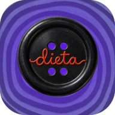

# 🪡 Coraline Tracker • Dieta per Asia

<div align="center">



**Un'esperienza mobile intima, sartoriale e immersiva, concepita su misura per Asia.**  
Ispirata all'universo dark fantasy e stop-motion di *"Coraline"* (Laika Studios / Henry Selick).

[](https://github.com/pzzmhl/dietasia/actions/workflows/build-apk.yml)
[](https://github.com/pzzmhl/dietasia/releases)
[](https://github.com/pzzmhl/dietasia/releases)
[](https://capacitorjs.com/)

</div>

---

## 🗝️ Concept & Esperienza Visiva

**Coraline Tracker** non è un banale contatore calorico: è un diario interattivo cucito a mano che trasforma il rispetto delle abitudini quotidiane (dieta, allenamento e costanza) in un viaggio atmosferico attraverso l'Altro Mondo.

Tra cieli stellati notturni, spirali ipnotiche del tunnel segreto, pietre verdi veggenti e bottoni neri cuciti con filo rosso, ogni scelta di Asia lascia un'impronta tangibile sul suo percorso.

---

## ✨ Funzionalità Principali

### 1. 🌑 La Luna Cinematografica & Eclissi del Bottone
- **7 Fasi Lunari Fotografiche:** La luna in primo piano reagisce allo stato della dieta negli ultimi 7 giorni.
- **Eclissi del Bottone:** Più giorni consecutivi vengono rispettati, più la luna si libera dall'ombra del grande bottone nero dell'Altra Madre; gli sgarri richiamano l'ombra, mentre le vittorie donano una luminescenza verde smeraldo.
- **Carosello a Box Concatenati:** Scorrimento orizzontale a tutto schermo tra *"La tua settimana"* e la schermata delle *"Statistiche comparative"*, con scorrimento fisico naturale a 120 FPS.

### 2. 📅 Calendario Mensile & Switch Modalità (Dieta & Allenamento)
- **Doppia Modalità Integrata:** Switch istantaneo tra il calendario **Dieta** (Pietra verde veggente / Bottone nero / Chiave jolly) e il calendario **Allenamento** (Palla cambio marcia di Bobinsky).
- **Esiti Tattili Immediati & Deselezione Rapida:**
  - 🟢 **Dieta Rispettata:** Pietra veggente verde smeraldo con aura rilassante.
  - ⚫ **Bottone Nero:** Sgarro registrato con finitura lucida a 4 fori.
  - 🔑 **Chiave Nera:** Sgarro autorizzato coperto da una chiave jolly senza penalizzare lo streak.
  - ↩️ **Toggle Intelligente:** Toccando la spunta già attiva nel modal giornaliero o allenamento si rimuove l'esito riportando il giorno allo stato neutro.
- **Swipe Orizzontale tra i Mesi:** Sfoglia i mesi con gesture orizzontale fluida e tocca il nome del mese per tornare a oggi.

### 3. 🗝️ Le Chiavi Nere dello Sgarro (Jolly Mensili)
- **Jolly Configurabili:** Asia dispone di chiavi speciali ogni mese (configurabili nelle impostazioni).
- **Aura Spettrale Dissolvenza:** Le chiavi utilizzate si trasformano in un'ombra argentata luminescente, proteggendo la serie positiva da eventuali interruzioni.

### 4. 🎪 Il Circo dei Topi Saltatori (Allenamenti di Bobinsky)
- **Card Quotidiana del Grande Bobinsky:** Notifica visiva per registrare se Asia si è allenata per il circo dei topi, con squillo di tromba celebrativo.
- **Pop-up e Reazioni Fotografiche:** Reazioni su misura per Asia con citazioni dinamiche di Mr. Bobinsky e dei suoi topolini acrobati.

### 5. 🐈‍⬛ Il Gatto Nero, Wybie & Il Topolino (Compagni Interattivi)
- **Saluto Quotidiano del Gatto Nero (`DailyCatGreetingModal`):** Ogni mattina il Gatto Nero accoglie Asia con una riflessione sartoriale legata al momento della giornata e all'andamento recente.
- **Il Gatto Nero Flottante (`CatModal`):** Veglia in basso a destra con animazione di respiro organica e oltre **500 osservazioni contestuali** (divise per fascia oraria, streak, rimonte e stato emotivo) estratte da code shuffle prive di ripetizioni.
- **Visite Coordinate di Wybie & del Topolino (`FloatingWybie` & `FloatingJumpingMouse`):** Si alternano ordinatamente nell'angolo inferiore sinistro per incoraggiare Asia o ricordarle i giorni non ancora compilati.
- **Eventi Storia & Traguardi (`StoryEventModal`):** Celebrazioni narrative sbloccate al raggiungimento di serie positive (3, 7, 14, 21, 30 giorni) o grandi rimonte.
- 📖 Consulta il catalogo integrale dei dialoghi in [`docs/PERSONAGGI_E_DIALOGHI.md`](docs/PERSONAGGI_E_DIALOGHI.md).

### 6. 📊 Dashboard & Statistiche Comparative
- **6 Schede Metriche Dedicate:**
  1. *Chiavi Jolly Disponibili* (rapporto rimaste/totali).
  2. *Giorni Rispettati nel Mese* (con Stella rossa del Circo).
  3. *Bottoni Neri* (conteggio sgarri non protetti).
  4. *Allenamenti Svolti* (Palla ingranaggio).
  5. *Tasso di Successo Mensile* (Percentuale precisa con Libellula).
  6. *Serie Attuale (Streak)* (Giorni consecutivi di fila).
- **Confronto con la Media Storica:** Ogni metrica calcola la variazione percentuale rispetto allo storico totale.

### 7. 🚪 La Porticina Segreta (6:3 Shuffle Bag & Dedica)
- **Portale Musicale e Video Bilanciato (`6:3 Shuffle Bag`):** Tocco singolo sulla Porticina in fondo alla pagina per aprire una sorpresa estratta da un mazzo pesato di 9 tessere (**6 brani Spotify** della colonna sonora ufficiale di Coraline e **3 video speciali su YouTube**), garantendo varietà matematica senza ripetizioni.
- **Easter Egg per Asia:** Pressione prolungata (`650ms`) per accedere alle impostazioni segrete e alla dedica d'autore:  
  *«Fatto con tutto l'amore del mondo dal tuo Michele per la sua Asia.»*

### 8. ⚡ Aggiornamenti OTA Silenziosi Zero-Click & Cloud Sync
- **Zero-Click Silent OTA Live Updates (`@capgo/capacitor-updater`):** Ogni nuova release su GitHub genera sia l'APK completo (`Coraline-Tracker-Beta.apk`) sia il bundle leggero `coraline-ota-bundle.zip`. L'app scarica e installa silenziosamente in background i nuovi aggiornamenti senza che Asia debba mai cliccare o confermare nulla, con protezione **Anti-Brick Rollback** automatica entro 10 secondi.
- **Offline-First + Supabase Cloud Sync Automatico:** Salvaguardia locale istantanea con doppio snapshot di emergenza in `localStorage` affiancata da una coda di sincronizzazione cloud (`syncQueue.js`) resiliente e priva di conflitti su Supabase.

---

## 🛠️ Architettura & Stack Tecnologico

```
┌──────────────────────────────────────────────────────────────┐
│                      CORALINE TRACKER                        │
├──────────────────────────┬───────────────────────────────────┤
│ Frontend Web             │ React 18 + Vite 5 (Code-Split ESM)│
│ Mobile Framework         │ Capacitor 6 (Android 120Hz Native)│
│ OTA Live Updates         │ @capgo/capacitor-updater (GitHub) │
│ Design System & Motion   │ Pure GPU CSS (Zero FBO Blur)      │
│ Backend & Cloud Backup   │ Supabase JS (Lazy) + SyncQueue    │
│ Hardware Integration     │ Capacitor Haptics & Notifications │
│ Audio Engine             │ HTML5 Web Audio API               │
└──────────────────────────┴───────────────────────────────────┘
```

- **Ottimizzazione Android 90Hz/120Hz Nativa:** `MainActivity.java` sblocca nativamente il refresh rate più elevato del display Android e forza il rendering hardware (`LAYER_TYPE_HARDWARE`). Tutte le superfici traslucide utilizzano vignette radiali pre-compositate senza `backdrop-filter` o `filter: blur()` offscreen, mentre un singolo `IntersectionObserver` condiviso (`useInViewport.js`) mette in pausa a `0% GPU` gli elementi fuori schermo.
- **Startup Istantaneo (-60% JS Bloccante):** Code-splitting granulare per i cataloghi di dialoghi (`cat-quotes`, `daily-cat-quotes`), l'SDK Supabase (`vendor-supabase`) e i modal secondari caricati on-demand con `React.lazy`.

---

## 📁 Struttura del Progetto

```
dietasia/
├── android/                 # Progetto nativo Android (Capacitor + 120Hz MainActivity)
│   └── app/src/main/res/    # Risorse mipmap, icone adattive e ic_launcher
├── docs/
│   └── PERSONAGGI_E_DIALOGHI.md # Compendio integrale di tutti i personaggi e dialoghi
├── public/                  # Asset pubblici statici (audio, favicon, apple-touch-icon)
├── resources/               # Asset master iOS (AppIcon.appiconset con Contents.json)
├── src/
│   ├── assets/              # Texture cinematografiche WebP, sprite e illustrazioni
│   │   ├── eclipse-phases/  # Le 7 fasi fotografiche della luna di Coraline
│   │   └── fonts/           # Font 'CoralinesCat' personalizzato
│   ├── components/          # Componenti modulari dell'interfaccia
│   │   ├── BobinskyWorkoutCard.jsx   # Card allenamento circo dei topi
│   │   ├── ButtonMoonEclipse.jsx     # Luna, streak e carosello a 2 schede
│   │   ├── CalendarGrid.jsx          # Griglia del mese e switch Dieta/Workout
│   │   ├── CatModal.jsx              # Tutor Gatto Nero e citazioni contestuali
│   │   ├── CoralineDivider.jsx       # Demarcatori: Mano, Scarafaggio, Armadio
│   │   ├── DailyCatGreetingModal.jsx # Saluto mattutino del Gatto Nero
│   │   ├── DaySelectionModal.jsx     # Modal di registrazione giornaliera (2x2)
│   │   ├── DayWorkoutModal.jsx       # Modal registrazione allenamento
│   │   ├── ErrorBoundary.jsx         # Protezione anti-crash React
│   │   ├── FloatingJumpingMouse.jsx  # Visite flottanti del Topolino Saltatore
│   │   ├── FloatingWybie.jsx         # Visite flottanti di Wybie Lovat
│   │   ├── MonthStatsBar.jsx         # Dashboard 6 metriche e confronti storici
│   │   ├── SecretDoor.jsx            # Porticina (6:3 Shuffle Bag + Easter Egg)
│   │   ├── SecretSettingsModal.jsx   # Impostazioni, profili, Cloud Sync e OTA
│   │   ├── StoryEventModal.jsx       # Celebrazioni narrative per traguardi
│   │   └── UpdateAvailableModal.jsx  # Modal di fallback per aggiornamenti APK
│   ├── constants/           # Chiavi di storage centralizzate
│   ├── data/                # Database citazioni e dialoghi contestuali
│   ├── hooks/               # Hook performance (useInViewport IntersectionObserver)
│   ├── services/            # Audio, Spotify/YouTube, Supabase Cloud Sync
│   ├── utils/               # Eclissi, statistiche, syncQueue, doorPortal, OTA updater
│   ├── App.jsx              # Orchestratore principale e gestione stato
│   ├── index.css            # Design System globale GPU-friendly e keyframe
│   └── main.jsx             # Entrypoint React
├── .github/workflows/       # CI/CD: build automatica APK + bundle OTA su GitHub Releases
├── capacitor.config.json    # Configurazione Capacitor & CapacitorUpdater Zero-Telemetry
├── index.html               # Shell HTML con caricamento font asincrono non bloccante
└── package.json             # Dipendenze e script di build
```

---

## 💻 Installazione & Sviluppo Locale

### Prerequisiti
- **Node.js** v18 o superiore
- **npm** v9 o superiore

### 1. Clona il repository e installa le dipendenze
```bash
git clone git@github.com:pzzmhl/dietasia.git
cd dietasia
npm install
```

### 2. Avvia il server di sviluppo locale
```bash
npm run dev
```
Apri [http://localhost:5173](http://localhost:5173) sul tuo browser o emulatore mobile.

### 3. Compilazione Web & Sincronizzazione Android
```bash
npm run cap:sync
```
Genera la build ottimizzata nella cartella `dist/` e sincronizza gli asset e i plugin nativi con il progetto `android/`.

---

## 🤖 Rilascio Automatico (APK + Zero-Click OTA su GitHub Actions)

Ad ogni nuovo tag semantico (es. `v2.8.3`), il workflow GitHub Actions [`.github/workflows/build-apk.yml`](.github/workflows/build-apk.yml) compila e pubblica automaticamente su [GitHub Releases](https://github.com/pzzmhl/dietasia/releases):
1. **`Coraline-Tracker-Beta.apk`** — Pacchetto di installazione Android nativo.
2. **`coraline-ota-bundle.zip`** — Bundle web OTA scaricato e applicato **in automatico e in background** dai dispositivi con l'app già installata, senza necessità di alcun clic.

```bash
git tag -a v2.8.3 -m "Release v2.8.3"
git push origin main --tags
```

---

<div align="center">

*«A volte le cose più preziose si trovano dietro la porticina più piccola.»*  
**Fatto con amore per Asia da Michele**

</div>
