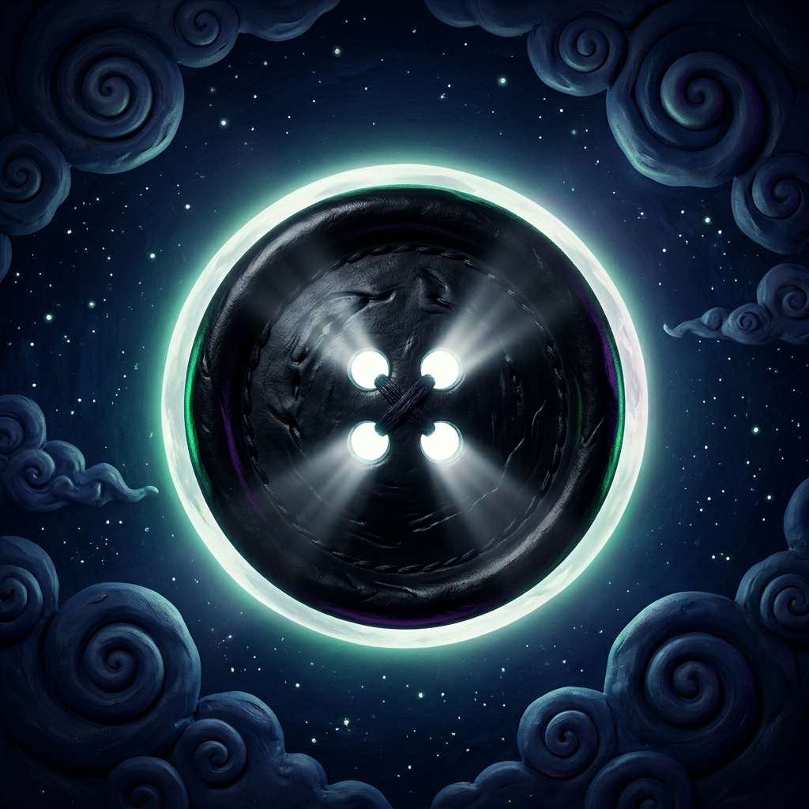

# 🪡 Coraline Tracker • Per Asia

<div align="center">



**Un'esperienza mobile intima, sartoriale e immersiva, concepita su misura per Asia.**  
Ispirata all'universo dark fantasy e stop-motion di *"Coraline"* (Laika Studios / Henry Selick).

[](https://github.com/pzzmhl/dietasia/actions/workflows/build-apk.yml)
[](https://github.com/pzzmhl/dietasia/releases)
[](https://capacitorjs.com/)

</div>

---

## 🗝️ Concept & Esperienza Visiva

**Coraline Tracker** non è un banale contatore calorico: è un diario interattivo cucito a mano che trasforma il rispetto delle abitudini quotidiane (dieta, allenamento e costanza) in un viaggio atmosferico attraverso l'Altro Mondo.

Tra cieli stellati sfocati, spirali ipnotiche del tunnel segreto, pietre verdi veggenti e bottoni neri da cucire sugli occhi, ogni scelta di Asia lascia un'impronta tangibile sul suo percorso.

---

## ✨ Funzionalità Principali

### 1. 🌑 La Luna Cinematografica & Eclissi del Bottone
- **7 Fasi Lunari Fotografiche:** La luna in primo piano reagisce allo stato della dieta negli ultimi 7 giorni.
- **Eclissi del Bottone:** Più giorni consecutivi vengono rispettati, più la luna si libera dall'ombra del grande bottone nero dell'Altra Madre; gli sgarri richiamano l'ombra, mentre le vittorie donano una luminescenza verde smeraldo.
- **Carosello a Box Concatenati:** Scorrimento orizzontale a tutto schermo tra *"La tua settimana"* e la schermata delle *"Statistiche comparative"*, con scorrimento fisico naturale senza ritagli artificiali.

### 2. 📅 Calendario Mensile & Switch Modalità (Dieta & Allenamento)
- **Doppia Modalità Integrata:** Switch istantaneo tra il calendario **Dieta** (Pietra verde veggente / Bottone nero) e il calendario **Allenamento** (Palla cambio marcia di Bobinsky).
- **Esiti Tattili Immediati:**
  - 🟢 **Dieta Rispettata:** Pietra veggente verde smeraldo con aura rilassante.
  - ⚫ **Bottone Nero:** Sgarro registrato con finitura lucida a 4 fori.
  - 🔑 **Chiave Nera:** Sgarro autorizzato coperto da una chiave jolly senza penalizzare lo streak.
- **Swipe Orizzontale tra i Mesi:** Sfoglia i mesi con gesture orizzontale fluida e tocca il nome del mese per tornare a oggi.

### 3. 🗝️ Le Chiavi Nere dello Sgarro (Jolly Mensili)
- **Jolly Configurabili:** Asia dispone di chiavi speciali ogni mese (configurabili nelle impostazioni).
- **Aura Spettrale Dissolvenza:** Le chiavi utilizzate si trasformano in un'ombra argentata luminescente, proteggendo la serie positiva da eventuali interruzioni.

### 4. 🎪 Il Circo dei Topi Saltatori (Allenamenti di Bobinsky)
- **Card Quotidiana del Grande Bobinsky:** Notifica visiva per registrare se Asia si è allenata per il circo dei topi.
- **Pop-up e Reazioni Fotografiche:** Foto originale a tutto schermo del Grande Bobinsky (con medaglia o a testa in giù) con citazioni su misura per Asia.
- **Design Uniforme:** Pulsanti nel tema cuoio/bronzo di Bobinsky senza fastidiosi rossi o verdi lampeggianti.

### 5. 🐈‍⬛ Il Gatto Nero (Tutor Virtuale Sornione)
- **Presenza Fissa Flottante:** Il Gatto Nero veglia in basso a destra con animazione di respiro organica, ottimizzato per non intralciare la gesture bar di Android.
- **Citazioni Contestuali:** Oltre 30 osservazioni ironiche, affettuose e misteriose doppiate in prosa in base all'andamento della dieta.
- **Musica Ambientale:** Sottofondo sonoro originale di Coraline con controllo del volume e pulsante mute istantaneo.

### 6. 📊 Dashboard & Statistiche Comparative
- **6 Schede Metriche Dedicate:**
  1. *Chiavi Jolly Disponibili* (rapporto rimaste/totali).
  2. *Giorni Rispettati nel Mese* (con Stella rossa del Circo).
  3. *Bottoni Neri* (conteggio sgarri non protetti).
  4. *Allenamenti Svolti* (Palla ingranaggio).
  5. *Tasso di Successo Mensile* (Percentuale precisa con Libellula).
  6. *Serie Attuale (Streak)* (Giorni consecutivi di fila).
- **Confronto con la Media Storica:** Ogni metrica calcola la variazione percentuale rispetto allo storico totale.

### 7. 🚪 La Porticina Segreta, Musica & Dedica
- **Portale Musicale Spotify:** Tocco singolo sulla Porticina in fondo alla pagina per avviare in shuffle la colonna sonora ufficiale di Coraline.
- **Easter Egg per Asia:** Pressione prolungata per accedere al messaggio d'amore segreto e alla dedica d'autore:  
  *«Fatto con tutto l'amore del mondo dal tuo Michele per la sua Asia.»*

---

## 🛠️ Architettura & Stack Tecnologico

```
┌────────────────────────────────────────────────────────┐
│                   CORALINE TRACKER                     │
├──────────────────────────┬─────────────────────────────┤
│ Frontend Web             │ React 18 + Vite (ESM)       │
│ Mobile Framework         │ Capacitor 6 (Android native)│
│ Design System & Motion   │ Pure CSS (Zero UI overhead) │
│ Backend & Backup (Opt.)  │ Supabase JS + LocalStorage  │
│ Hardware Integration     │ Capacitor Haptics & Notif.  │
│ Audio Engine             │ HTML5 Web Audio API         │
└──────────────────────────┴─────────────────────────────┘
```

- **CSS & Performance:** Zero librerie pesanti di componenti; CSS puro basato su variabili di design tokens, trasformazioni GPU (`translate3d`), subpixel font antialiasing e rispetto per `prefers-reduced-motion`.
- **Offline-First:** L'applicazione è autonoma al 100% senza connessione internet, salvando i dati con doppio snapshot ridondante di emergenza in `localStorage`.
- **Cloud Sync Opzionale:** Backup e ripristino istantaneo su database Supabase configurabile dal pannello impostazioni.

---

## 📁 Struttura del Progetto

```
dietasia/
├── android/                 # Progetto nativo Android (Capacitor)
│   └── app/src/main/res/    # Risorse mipmap, icone adattive e ic_launcher
├── public/                  # Asset pubblici statici (audio, icone PWA, favicon)
├── resources/               # Asset master iOS (AppIcon.appiconset con Contents.json)
├── src/
│   ├── assets/              # Texture cinematografiche, sprite e illustrazioni
│   │   ├── eclipse-phases/  # Le 7 fasi fotografiche della luna di Coraline
│   │   └── fonts/           # Font 'CoralinesCat' personalizzato
│   ├── components/          # Componenti modulari dell'interfaccia
│   │   ├── BobinskyReactionModal.jsx
│   │   ├── BobinskyWorkoutCard.jsx
│   │   ├── ButtonMoonEclipse.jsx    # Luna, streak e carosello a 2 schede
│   │   ├── CalendarGrid.jsx         # Griglia del mese e switch Dieta/Workout
│   │   ├── CatModal.jsx             # Tutor Gatto Nero e citazioni
│   │   ├── CoralineDivider.jsx      # Demarcatori: Mano, Scarafaggio, Armadio
│   │   ├── DaySelectionModal.jsx    # Modal di registrazione giornaliera (2x2)
│   │   ├── DayWorkoutModal.jsx      # Modal registrazione allenamento
│   │   ├── JumpingMouseNotice.jsx   # Allarme giorni mancanti Bobinsky
│   │   ├── MonthStatsBar.jsx        # Dashboard 6 metriche e tooltips
│   │   ├── SecretDoor.jsx           # Porticina Spotify ed Easter Egg
│   │   ├── SecretLoveModal.jsx      # Messaggio segreto per Asia
│   │   └── SecretSettingsModal.jsx  # Impostazioni, profili e backup
│   ├── services/            # Moduli di servizio (aptica, notifiche, Spotify, audio)
│   ├── utils/               # Logica pura di calcolo (eclissi, medie, storage)
│   ├── App.jsx              # Orchestratore principale e gestione layout
│   ├── index.css            # Design System globale, reset e keyframe stop-motion
│   └── main.jsx             # Entrypoint React
├── .github/workflows/       # CI/CD: build automatica APK Android e release
├── capacitor.config.json    # Configurazione Capacitor (App ID com.asia.coralinehabit)
├── index.html               # Shell HTML con preconnect Google Fonts (Cinzel + Space Grotesk)
└── package.json             # Dipendenze e script di build
```

---

## 💻 Installazione & Sviluppo Locale

### Prerequisiti
- **Node.js** v18 o superiore
- **npm** v9 o superiore

### 1. Clona il repository e installa le dipendenze
```bash
git clone git@github.com:pzzmhl/dietasia.git
cd dietasia
npm install
```

### 2. Avvia il server di sviluppo locale
```bash
npm run dev
```
Apri [http://localhost:5173](http://localhost:5173) sul tuo browser o emulatore mobile.

### 3. Compilazione Web
```bash
npm run build
```
Genera la build ottimizzata pronta per la produzione nella cartella `dist/`.

---

## 🤖 Compilazione APK Android

### Compilazione Locale con Android Studio
Se hai Android Studio configurato:
```bash
npx cap sync android
npx cap open android
```
Da Android Studio, seleziona **Build > Build Bundle(s) / APK(s) > Build APK(s)**.

### Compilazione Cloud Automatica (GitHub Actions)
Non è necessario avere Android Studio installato sul computer:
1. Ad ogni `push` sul ramo `main`, il workflow GitHub Actions compila automaticamente l'APK di debug in cloud.
2. Vai nella scheda **Actions** del repository su GitHub.
3. Seleziona l'ultima esecuzione del workflow **"Build Android APK (Coraline Tracker)"**.
4. Nella sezione **Artifacts** in basso troverai il file **`Coraline-Tracker-Beta-APK`** pronto da scaricare e installare sullo smartphone.
5. Per creare una **Release Ufficiale** numerata con APK allegato pubblico, basta inviare un tag git (es. `git tag v2.6.0 && git push origin v2.6.0`) oppure attivare il workflow manualmente con l'opzione `create_release: true`.

---

<div align="center">

*«A volte le cose più preziose si trovano dietro la porticina più piccola.»*  
**Fatto con amore per Asia da Michele**

</div>
